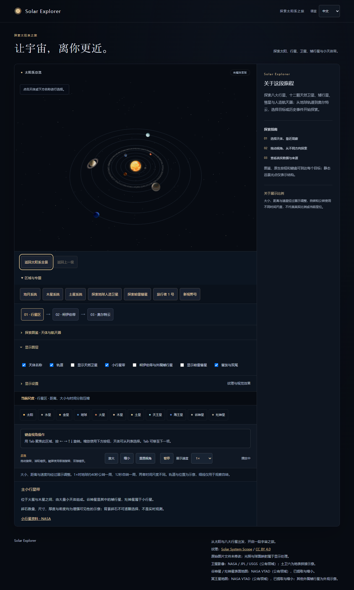

# Solar Explorer

**[▶ 公開デモ](https://aswobb.github.io/solar-explorer/)**

P8統合版の公開はmainへのpushからGitHub Pages Actionsで行います。[最新の配信結果](https://github.com/aswobb/solar-explorer/actions/workflows/pages.yml)を確認できます。実機スマートフォン性能の受け入れ確認は引き続き未完了です。

太陽と8惑星、12の天然衛星、準惑星、彗星、人造宇宙機、外縁領域を、自分の視点で探索するインタラクティブな太陽系図鑑です。React / TypeScriptとWebGLによる3D表現、カメラ制御、科学データの表示を組み合わせています。バックエンドは使用しません。



## できること

- 地球の詳細から地球と月の系へ移動し、月の選択・追従・親階層への復帰
- 太陽と8惑星の自転・公転、一時停止、0.25×〜5×の速度変更
- マウス・タッチ・キーボードによる視点操作、天体の選択、滑らかな接近と追従、全景への復帰
- 概要・実際の代表値・単位・出典の表示、日本語 / 中文 / English の切り替え
- 地球の昼夜・雲・大気、土星の環、太陽の動的表面・コロナと光彩
- 表示品質の標準 / 軽量切り替え、各効果の個別オフ、画像読込失敗時の基本表示
- モバイルの単一カラム、キーボードのフォーカス表示、手動で選べる「動きを減らす」（初期状態は自動再生）

太陽系の恒星は太陽だけです。背景の星は装飾用の点群で、太陽系メンバーや実際の星図を表しません。

## 起動

Node.js **24 LTS**、npm **10.5.1以上**を使用します。`.nvmrc` は24です。組み込みのTypeScript読み込みを使うテストも、この手順ではNode24で実行します。

```sh
npm ci
npm run dev
```

ターミナルに表示されたURLを開きます。ポートが使用中なら別ポートが選ばれるため、以前のURLを固定で使わないでください。特定のポートで起動する場合：

```sh
npm run dev -- --port 5175 --strictPort
```

同じWi-Fiのスマートフォンから確認する場合：

```sh
npm run dev -- --host 0.0.0.0 --port 5175 --strictPort
```

表示されたNetwork URLをスマートフォンで開きます。スマートフォン上の `127.0.0.1` はPCを指しません。確認後はターミナルでCtrl+Cを押すと停止します。

## チェックと本番ビルド

```sh
npm run typecheck
npm test
npm run build
npm run check:dist
npm run preview
```

`build` は型検査とViteビルドを実行し、`dist/` を生成します。`preview` は生成物をローカルで確認するサーバーです。公開版はGitHub Pagesで配信しています。[配信手順](docs/DEPLOYMENT.md)を参照してください。

## 技術と構成

| 分野 | 採用技術・実装 |
|---|---|
| 画面 | React 19、TypeScript 5.9、CSS |
| 3D | Three.js r180、React Three Fiber 9、Drei 10 |
| ビルド | Vite 8、静的ファイル出力 |
| データ | 型付きの天体・単位・出典、表示用パラメータと分離 |
| 検証 | Node.js組み込みテスト、型検査、実ブラウザでの操作確認 |

正確な依存バージョンは `package-lock.json` を参照してください。フレームごとの座標はrefで更新し、React状態は選択・UI設定・カメラ状態の切り替えに使います。

- [静的配信の準備](docs/DEPLOYMENT.md)：ルート・子ディレクトリの配置と本番生成物の検査
- [スクリーンショット](docs/showcase/README.md)
- [操作ガイド](docs/GUIDE.md)：探索の流れ、入力方法、設定、トラブル対処
- [アーキテクチャ](docs/ARCHITECTURE.md)：状態と時間の所有、カメラ、材質、リソース解放
- [出典・素材・署名](docs/CREDITS.md)：NASA/JPLの資料、画像の作者・ライセンス、取得記録

## 検証結果と既知の制限

2026-10-22に、型検査・**45件のテスト**・本番ビルドと、IAB実ブラウザでの探索・表示設定・エラー復帰を確認しました。[検証条件と結果](docs/VALIDATION.md)、[描画負荷の測定条件](docs/PERFORMANCE.md)を保存しています。テスト数はこの時点の記録です。

- 大きさ・距離・速度は実際の比率ではありません。1×の地球は公転約40秒・自転約12秒で、時間尺度も別です。円軌道・軸の向きは模式的で、現在の星位を再現しません。
- 画像とshaderは可視化用です。金星は雲の下の地表、夜景は合成画像、雲・大気・太陽活動は演出です。物理的な散乱、環の投影、リアルタイム観測ではありません。
- 軽量モードでも画像の解像度と追加効果の細分は同じです。ダウンロード量や全描画負荷が同じ割合で減るわけではありません。
- 3D分包には500kB超のビルド警告が残っています。FPSやGPU使用メモリは未測定です。
- 端末設定の実切り替え、スクリーンリーダー、強制カラーモード、実際の200%ブラウザ拡大、高DPI切り替え、複数ブラウザの網羅検証は未実施です。スマートフォンの基本操作は利用者の実機確認を得ていますが、機種・OS・ブラウザは記録していません。
- 収録済み12衛星以外の衛星、実寸モード、重力計算、バックエンド、ログインは実装していません。画面サイズ変更後も手動の視点を保つため、必要に応じて天体を再選択して取景し直します。

## 出典・ライセンス

科学値はNASA/JPL・NASA GSFCの公開資料を参照しています。画像13点は **© Solar System Scope / INOVE**、[CC BY 4.0](https://creativecommons.org/licenses/by/4.0/)。[提供元](https://www.solarsystemscope.com/textures/)と[素材署名](public/textures/ATTRIBUTION.md)を参照してください。ミラー取得ファイルは未変更で、照明・UV・雲・コロナなどは実行時の表示処理です。原サイトとのバイト一致は独立に確認していません。

P2で追加した5衛星の画像はNASA/JPL/USGSのパブリックドメインとして配布されるミラー画像です。既存のCC BY 4.0画像と区別し、出典と取得条件を `public/textures/ATTRIBUTION.md` に記録しています。

画像のCC BY 4.0をプロジェクト全体のコードライセンスとして扱いません。プロジェクト固有コードのライセンスは未設定です。依存ライブラリの記録は[出典・署名](docs/CREDITS.md#依存ライブラリ)にまとめています。

P1（2026-11-02）で月と地球・月の局部表示を追加しました。[第二弹扩展计划](docs/plan-第二弹扩展.md)、[検証記録](docs/VALIDATION.md)、[地球と月の画面](docs/showcase/earth-moon.png)を参照してください。初期表示は自動再生です。

开发计划：[基础版](docs/plan-基础版.md) · [第二弹扩展](docs/plan-第二弹扩展.md)

P2（2026-11-02）：木星のイオ・エウロパ・ガニメデ・カリスト、土星のタイタンを追加。画面の「地球と月 / 木星系 / 土星系」から切り替え、衛星の選択・追従・親階層への復帰ができます。

P2追加：土星系にはタイタンに加えてミマス、エンケラドス、テティス、ディオネ、レア、イアペトゥスを収録。追加6衛星の画像はNASA公式3D Resourcesから取得しました。

P3（2026-11-02）：火星と木星の間に小惑星帯を追加。ケレス（準惑星）とベスタ（小惑星）を選択・追従でき、レイヤーから切り替えられます。背景粒子は固定シードの模式表現で、実際の密度や現在位置を示しません。表面図はNASA VTADの公式モデルから抽出・縮小しています。

P4（2026-11-02）：冥王星・エリス・ハウメア・マケマケとカイパーベルトを追加。分類付き天体図鑑は中日英の名称で検索でき、準惑星はケレスを含め5天体です。外縁表示は独立した取景を使い、元の惑星・衛星へ戻れます。未観測の外観は模式図として明記しています。

P5 已加入哈雷彗星：通过“探索哈雷彗星”进入，或使用近日点/远日点跳转。双尾随距离变化，可独立关闭；轨道为展示模型。详见 [P5说明](docs/COMETS.md)。

P6 已加入“行星区 → 柯伊伯带 → 奥尔特云”三级导航、对数距离标尺与返回原视角。详见 [奥尔特云说明](docs/OORT-CLOUD.md)。

P7 已加入人造航天器：地球轨道中的国际空间站/哈勃，以及旅行者1号/新视野号历史任务时间线。支持跟随、节点跳转及退出后恢复原时间和视角。详见 [航天器说明](docs/SPACECRAFT.md)。

## P8 統合版 / 整合版

32対象の統一図鑑、共有ナビゲーション・レイヤー、全景/親階層への復帰、すべての画面から開ける表示設定を提供します。航天器のズーム時選択と外縁からの復帰も修正しました。

79項目のテスト、型検査、静的ビルド、27画像のハッシュ/署名検査、Edgeでのキーボード・タッチ・画像失敗・WebGL再試行を検証。[P8验收记录](docs/RELEASE-P8.md)、[性能数据](docs/performance/p8-measurements.json)。実機スマートフォンGPU性能の確認は未完了です。

可选浏览器验证（Node24、Playwright 与本机 Microsoft Edge，先启动5176开发服务）：

```sh
node scripts/verify-ui.mjs
node scripts/measure-performance.mjs
```

Playwright 是额外的本地验证工具，不属于网页运行依赖；当前工作区已安装。独立环境需自行准备 Playwright/Edge，`npm ci` 只安装项目声明的构建依赖。性能脚本使用同一台PC的桌面与手机视口模拟，不代表真实手机性能。
