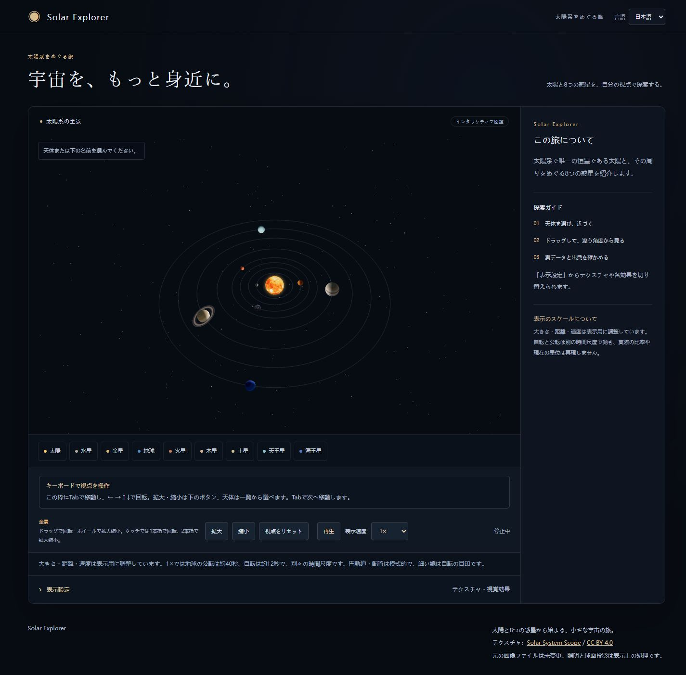
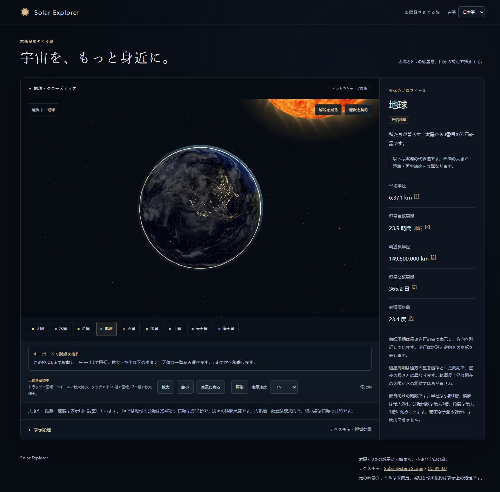

# 展示用スクリーンショット

[READMEへ戻る](../../README.md)

2026-10-22にIABで撮影したローカル本番ビルドです。デスクトップは1440×1000のブラウザ視口で全ページ、モバイルは390×844の視口をキャプチャしています。スクロールバーにより画像の実幅は視口幅と異なる場合があります。全て日本語・標準品質・画像と追加効果オン、光彩「標準」。一時停止して撮影し、選択時は「動きを減らす」で即時取景しています。外部加工や合成はしていません。

| ファイル | 内容 |
|---|---|
| [overview.png](overview.png) | 太陽と8惑星の全景とガイド |
| [earth.png](earth.png) | 地球の昼夜・雲と代表値 |
| [saturn.png](saturn.png) | 環を含めた土星の近景 |
| [sun.png](sun.png) | 太陽の表面・コロナと適用外の公転情報 |
| [mobile.png](mobile.png) | 子ディレクトリの本番表示、モバイル幅の土星 |

他天体が近景の背景に写る場合があります。天体の位置・大きさ・距離は模式表示です。画像の昼夜や太陽は観測時点を表しません。モバイル画像はブラウザの視口検証であり、実機の画面キャプチャではありません。
スクリーンショット中の天体素材：© Solar System Scope / INOVE、[CC BY 4.0](https://creativecommons.org/licenses/by/4.0/)、[提供元](https://www.solarsystemscope.com/textures/)。原画像のミラーファイルは未変更、表示は本アプリの投影・照明・shaderによる処理です。[詳細な署名](../CREDITS.md)

P1 地月系统（2026-11-02）：[地球与月球局部视图](earth-moon.png)。截图为本地开发版本，展示比例与真实尺寸、距离不同。

P2（2026-11-02）：[木星四大卫星系统](jupiter-system.png) · [土星与土卫六系统](saturn-system.png)。均为展示比例，局部轨道与天体大小独立压缩。

土星系统截图已于 2026-11-02 更新为七卫星版本：土卫一、二、三、四、五、六和八。

P3（2026-11-02）：[小行星带全景](asteroid-belt.png) · [谷神星近景](ceres.png)。碎石密度与天体大小为展示比例，谷神星表面地图来自 NASA VTAD。

P4（2026-11-02）：[柯伊伯带外围视图](kuiper-belt.png) · [冥王星近景](pluto.png)。

P5（2026-11-02）：[哈雷彗星近日点双尾](halley-comet.png)。轨道、彗核与尾部均为展示比例。

P6（2026-11-02）：[奥尔特云远景](oort-cloud.png)。球壳为推测结构示意，中心青色盘为柯伊伯带，采用非线性距离比例。

P7（2026-11-06）：[地球人造卫星](earth-orbiters.png) · [旅行者1号路线](voyager-mission.png) · [新视野号路线](new-horizons-mission.png)。模型和空间路线均为示意，只有事件日期基于历史资料。

P8（2026-11-06）：[桌面统一探索界面](p8-overview.png) · [390×844触控模拟](p8-mobile.png)。截图不表示实体手机性能测试。
